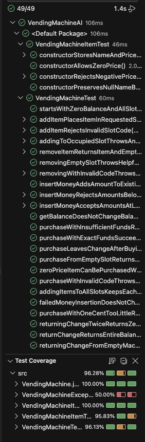

# AI Test Review

The tests written by ChatGPT were very well built. There were more tests
than the human-written suite with 30 more tests, and covers all kinds of
inputs that humans typically wouldn't test or think of. ChatGPT's quality
was better for covering certain cases, like boundary inputs that humans
may not have tested for.

The coverage-guided promoting did not improve the suite as the coverage
was already at 100%. I did prompt ChatGPT to improve the tests, and it
added tests to cover some edge cases in consecutive to verify that state
is properly saved, and removed an un-used parameter test by using
`ValueSource` instead.

AI is able to create more detailed test cases that cover boundary cases,
and consider inputs, that technically don't need to be tested, but may
have some impact on the user-end side. It also does make some mistakes
like leaving un-used tests in the suites, or may inflate test suites by
creating additional cases that don't really need to be validated, such
as the `purchaseWithOneCentTooLittleReturnsFalseAndPreservesState`
test.

