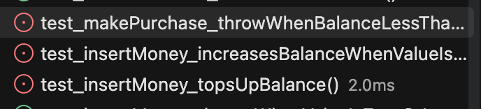

# Coverage

## Before Changes

| Source File             | Initial Statement/Line Coverage | Initial Branch Coverage |
| ----------------------- | ------------------------------- | ----------------------- |
| VendingMachine.java     | 90.70%                          | 100%                    |
| VendingMachineItem.java | 100%                            | 100%                    |

## After Changes

VendingMachine tests were improved to 100% coverage. Tests were added for `getBalance` to
check balance return logic, and `returnChange` to check that balance is properly emptied,
and the change is equal to the old balance. 

| Source File             | Final Statement/Line Coverage   | Final Branch Coverage   |
| ----------------------- | ------------------------------- | ----------------------- |
| VendingMachine.java     | 100%                            | 100%                    |
| VendingMachineItem.java | 100%                            | 100%                    |

## Condition Coverage Analysis

I picked the compound decision in makePurchase. The first condition, "item !== null" simply
checks that the item isn’t null, and "this.balance >= item.getPrice()" checks that the vending
machine’s balance is more than or equal to the item’s price so that the item can be bought.

The tests `test_makePurchase_throwWhenItemNull` and `test_makePurchase_throwWhenBalanceLessThanItemPrice`
validate that the conditions are set to false to verify the logic returns false as expected.
Since this is an AND operation, we don’t need to test that the function returns its proper
output with only one true condition. `test_makePurchase_removeItemAndDecrement` returns true
when the conditions are met correctly.

## Fault Injection Results

I added a fault in VendingMachine#insertMoney by changing the if-statement to check that the
amount is less than OR EQUAL to 1, and if it’s true, it would fail. The following tests failed:

