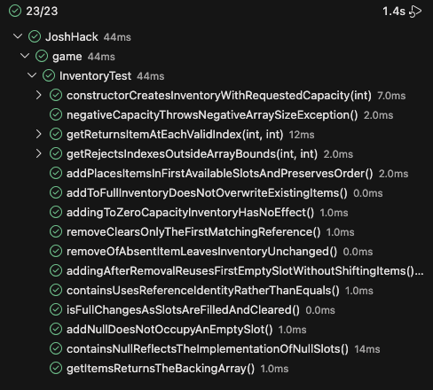

# JoshHack Coverage

## Before Changes

No tests were written at all.

| Source File    | Initial Statement/Line Coverage | Initial Branch Coverage |
| -------------- | ------------------------------- | ----------------------- |
| Inventory.java | 0%                              | 0%                      |

## After Changes

I prompted ChatGPT to add tests for Inventory. These tests verify that the proper Items are
returned at the appropriate indexes, reference identity checking (because Java works with
references, how fun!), and boundary checking when working with arrays. 

Chat source: <https://chatgpt.com/share/6ad2ed73-9f94-83ea-ad30-4c105b5ee869>

| Source File    | Final Statement/Line Coverage | Final Branch Coverage |
| -------------- | ----------------------------- | --------------------- |
| Inventory.java | 100%                          | 100%                  |

